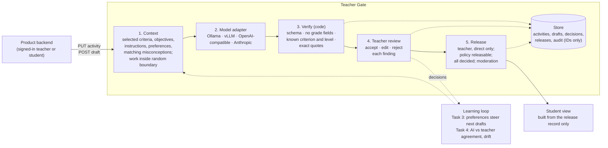
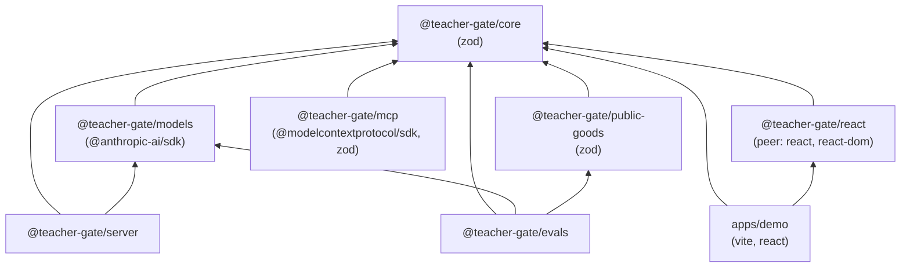

# Architecture

Teacher Gate sits between a language model and a classroom product. The product keeps its own
users, sign-in and classes. Teacher Gate keeps activities, drafts, the teacher's decisions,
releases and an audit log, and enforces who may do what with AI output.

## The flow



1. **Context** (`packages/core/src/context.ts`). `buildFeedbackContext` puts the teacher's selected
   rubric criteria, the activity's title, prompt and objectives, the teacher's instructions, the
   preferences derived from past decisions, and up to 8 misconception entries that share a
   standard with the activity into the system prompt. Student work never appears in the system
   prompt. It goes in the user message inside an untrusted-content block
   (`packages/core/src/boundary.ts`) whose boundary token is 128 random bits, drawn per request.
   A policy of `none`, empty work, or work over 40,000 characters (configurable) yields a
   `skipped` draft without calling the model.
2. **Model** (`packages/core/src/model.ts`, `packages/models`). One interface, `ModelAdapter`, with a
   single `complete` method. The core never imports a provider SDK. Requests ask for JSON at
   temperature 0. A thrown call is retried once by default; if every attempt fails the draft is
   `failed`.
3. **Verify** (`packages/core/src/verify.ts`). `verifyFindings` keeps a finding only if it parses
   against a strict schema, carries no grading field (`score`, `grade`, `points`, `mark`,
   `approved`, `approval`, `release`, `released`, `final`), names a criterion that exists and that
   the teacher selected, names a level that criterion has (if any), and every excerpt's quote
   occurs exactly in the named artifact. Quotes are never fuzzy-matched. A failing finding is
   dropped whole and only its reason is kept. Output that is not a JSON object with a `findings`
   array gives an `invalid-output` draft.
4. **Teacher review** (`packages/core/src/views.ts`, `packages/react`). `teacherDraftView` shows each
   verified finding with its evidence ranges, uncertainty, suggested level (teacher only), the
   decision in force, a `gradeLanguage` flag when the text states a score or a level, counts of
   dropped findings by reason, and the release blockers.
5. **Release** (`packages/core/src/gate.ts`). `release` requires a teacher acting directly, a
   `releasable` policy at the time of release, a `completed` draft, a decision on every finding,
   at least one finding not rejected, no accepted finding that states a grade or level, and
   moderation passing every student-facing text. It writes a `ReleaseRecord`: a snapshot of the
   accepted findings in the model's words and the edited ones in the teacher's. It is idempotent.

**Student view.** `studentView` and `studentFeedbackView` read only the latest release record for
a submission. A student may read only a submission whose `learnerRef` equals their actor id.
Before release a student sees an empty list, with no hint whether a draft exists. If the
activity's policy has since been tightened from `releasable`, the released feedback is withdrawn
from view.

**Learning loop.** Decisions are records. `derivePreferences` (`preferences.ts`) reads them for
the next draft on the same activity (Task 3). Goal monitoring (`goals.ts`) pairs the AI's
judgement of a teacher's goal with the teacher's own and reports agreement over time (Task 4).

Tasks 2 and 4 and the language variants follow the same pattern: untrusted input inside a random
boundary, output verified in code, and nothing saved or shown to a student until a teacher
acting directly decides. See the [tutorials](tutorials/).

## Package dependencies



`@teacher-gate/mcp` uses `@teacher-gate/server` only in its tests. Packages are published from
source (`exports` point at `src/*.ts`); there is no build step yet, and they run under `tsx` or a
TypeScript-aware bundler.

## Access rules

These rules live in the core (`packages/core/src/gate.ts`), not in the UI or the HTTP layer, so
every entry point (HTTP, MCP, embedded) is subject to them.

### Actors

Every call carries an `Actor` (`packages/core/src/records.ts`):

```ts
interface Actor {
  id: string;
  role: "teacher" | "agent" | "student" | "service";
  channel: "direct" | "agent" | "api";
}
```

`direct` means a person acting in the developer's own product, signed in. `agent` means an AI
agent or another harness.

### Who may do what

| Action | Allowed for |
|---|---|
| Put an activity; set a preference | teacher on `direct` |
| Decide on a finding (accept, edit, reject); release | teacher on `direct` |
| Confirm, reject or reassign a brief mapping; save a brief | teacher on `direct` |
| Create a goal; record the teacher's own goal judgement | teacher on `direct` |
| Approve a language or reading-level variant | teacher on `direct` |
| Draft feedback, a brief, a variant; dry-run or evaluate a goal | any role except `student` |
| Read drafts, briefs, goal reports, the audit log | any role except `student` |
| Read an activity or its preferences | any caller with a valid token |
| Read the student view | a student whose id is the submission's `learnerRef`; any non-student to preview |

In short: **only a teacher acting directly decides or releases. Agents and services draft and
read. Students read only their own released feedback.** Every allowed and denied action is
written to the audit log, by ID.

### Token kinds (HTTP service)

The HTTP service (`packages/server/src/server.ts`) maps each bearer token to a kind. The deployer
sets the kind; the caller cannot.

| Kind | Held by | Acts as |
|---|---|---|
| `product` | the developer's own backend, after it signs the user in | the `X-Actor-Id` and `X-Actor-Role` it sends (`teacher`, `student` or `service`), always on channel `direct` |
| `agent` | an AI agent or another harness, such as the MCP server | always role `agent` on channel `agent`, whatever headers it sends |

So an agent token can never pose as a teacher. The product backend is trusted to set
`X-Actor-Role: teacher` only for a signed-in teacher of that class. Teacher Gate cannot check that
itself; see [security and privacy](security-and-privacy.md).

### Policies

Each activity has an AI-help policy (`aiHelp`):

- `none`: no model reads the work. Drafts are `skipped`.
- `teacher-only`: findings are advice to the teacher and can never be released.
- `releasable`: the teacher may release reviewed findings.

The policy in force at release time decides, not the one when the draft was made.

## Records

| Record | Collection | Holds student text? |
|---|---|---|
| `Activity` | `activities` | No (the teacher's rubric, prompt and guidance) |
| `FeedbackDraft` | `drafts` | Quoted excerpts and observations |
| `DecisionRecord` | `decisions` | The model's and the teacher's observation text |
| `ReleaseRecord` | `releases` | Released text and excerpts |
| `BriefDraft`, decisions, `SavedBrief` | `briefs`, `briefs:decisions`, `briefs:saved` | Quoted excerpts |
| `Goal`, goal observations | `goals`, `goal-runs`, `goal-judgments` | No (the goal statement and met / not met) |
| `AuditRecord` | the audit log | **No.** IDs, action, actor, outcome and reason only |

Drafts and releases hold quotes from student work because the teacher must see the evidence. The
audit log never does. Records identify a student only by the caller's opaque `learnerRef`.
